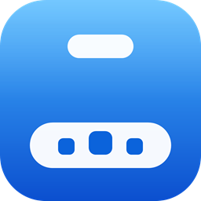

<p align="center"></p>

# Bến

A liquid-glass shell for Windows 11. It replaces the taskbar with a glass dock along the bottom edge and a dynamic island along the top edge of every monitor. Written in Rust, drawn with Windows Composition.

## Download
- https://github.com/GnimDev/ben-dock/releases/tag/test
## Features

- **Dock:** pinned and running apps. Icons magnify under the cursor, show live window previews on hover, and can be dragged to reorder. Drag an app, shortcut or file onto the dock to pin it: the glass strains like the skin of a water drop, then lets the icon slip in. Dividers group the pinned apps. The first icon opens an app launcher with search, made of the same glass as the dock; tapping the Windows key opens it too, in place of the Start menu.
- **Desktop bubble:** a round bubble of its own beside the dock. Click it and every window goes out of the way, back to the desktop. It is only there while a window is showing. Turn it off with **Nút về màn hình chính cạnh dock** in the settings, or `desktop_button = false` in `ben.ini`.
- **App tray:** every installed app, the ones you use most on the first page and installers and admin tools on the last. Icons are kept in a file (`icons.cache`), so the tray opens full. Search ignores case and accents and finds apps by initials (`vsc`), short names (`cmd`, `calc`), program names (`winword`), several words (`ms word`) and small typos (`notepda`); what you picked before comes first. Drag a tile onto the dock to pin it.
- **Dynamic island:** clock, date, network and battery. It expands for volume, charging, connectivity and now-playing changes. Hover it to open a control panel with media controls, volume, Wi-Fi, Bluetooth, audio output, battery, a calendar and power buttons.
- **Now playing:** cover art, a seek bar, shuffle and repeat for whatever player Windows reports (Spotify included). No account or sign-in is needed.
- **Background apps:** the apps that run in the background, whose icons the Windows taskbar keeps in its corner, have a card of their own on the island's first page, under the Wi-Fi, Bluetooth, sound and battery cards. Click, double-click or right-click an icon there and its program gets the click as it would from the taskbar: its window opens, or its own menu shows. The name of the app under the cursor is written beside the card's title.
- **Four corners:** a small glass pill in each corner of the screen. Hover one to open its list.
  - Top-left, **Claude:** the share of the weekly limit used when Claude Code has a current figure, otherwise today's tokens. Read from the files Claude Code keeps on this computer; it never reads Claude's sign-in.
  - Top-right, **notifications:** a bell with a count. Each new app notification swells out as a card. In the list, click one to open its app or the ✕ to dismiss it.
  - Bottom-left, **weather:** temperature and sky for where the computer is. The location, rounded to about 10 km, is sent to Open-Meteo.
  - Bottom-right, **system:** CPU and memory in use. Click the very corner of the screen to show the desktop.
- **Desktop widgets:** glass cards that lie on the desktop, under your windows. Drag one anywhere; each can be switched on or off.
  - **Clock** and **calendar:** the time and date, and this month with today marked.
  - **System monitor:** CPU with its last minute as a graph, memory, disk, network speed and battery.
  - **To-do:** the tasks in `todo.txt`. Click one to tick it off.
  - **Focus timer:** stretches of focus with a rest after each (Pomodoro).
  - **Note:** the text of `note.txt`.
  - **Progress:** how much of the day, week, month and year has gone by.
- **Live wallpaper:** optional water in place of the desktop picture, dark or blue. The cursor leaves ripples on it, a click sends rings out, and music makes drops fall in time with the beat. It only reads how loud Windows is playing; nothing is recorded.
- **Out of the way of maximized windows:** by default no screen space is reserved. While a maximized window is showing, the dock, the island and the corners leave, and a small white bar stays at the bottom edge. Put the cursor on the bar and the dock and island come back; 2 seconds after the cursor leaves, the dock goes again and the island shrinks to the time alone for 8 more seconds (hover it to get the whole island back). Volume, charging and now-playing changes still bring the island in for a moment. The dock and the island can each be told to stay instead, and maximized windows can be kept off either (see Usage).
- **Floating windows:** new windows open centered at up to 70% of the screen instead of maximized.
- **Minimize effects:** windows minimize into their own dock icon. A genie-style effect plays when you click the icon, and when you minimize a window with its own button or the keyboard. A window that is out of sight behind a maximized one flies out of its icon in the same way when you click it.
- **Themes:** four glass materials, light/dark mode, accent tint.
- **Multiple monitors:** each monitor gets its own dock and island.

## Build and run

1. Run `setup.bat` once. It checks for Rust and a linker, and asks before installing anything that's missing.
2. Run `build.bat`. The output is `dist\ben.exe`, and it starts automatically after the build. Use `build.bat norun` to skip starting it.
3. Right-click the dock and choose **Start with Windows** to run Bến at login.

Both Rust toolchains work: MSVC (needs the C++ Build Tools) or GNU (needs MinGW's `dlltool` and `as` on PATH, e.g. `C:\msys64\ucrt64\bin`).

## Usage

- **Windows key:** a tap of the Windows key on its own opens the app tray; start typing to search. A dock that is tucked away comes into view with it. Win+D, Win+E and the like work as before, and Ctrl+Esc still opens the Start menu. Turn it off with **Phím Windows mở khay ứng dụng** in the settings, or `win_key = false` in `ben.ini`.
- **Pinning by drag and drop:** drag an app, shortcut or file from Explorer, the desktop or the app launcher onto the dock. Its icon squeezes in and follows the cursor; drop it where it should stay. A tile dragged out of the app launcher closes the launcher and travels in a glass bubble under the cursor.
- **Unpinning by drag:** drag a pinned icon up out of the dock and let go. It leaves in a bubble that bursts. Bring it back over the dock before letting go to keep it. An app that is open stays in the dock, among the open apps, until it closes.
- **Dividers:** right-click a pinned icon and choose **Thêm vách ngăn phía sau** to put a divider after it. Drag a divider to move it; right-click it to remove it. Dividers are saved in `pins.txt` as `---` lines.
- **Dock:** right-click an icon for app actions. Right-click empty space on the dock for settings, showing the Windows taskbar, autostart and quit.
- **Settings:** open them from the dock menu, or edit `ben.ini` next to `ben.exe`. Changes apply immediately. The window is sorted into tabs: look, dock, island and corners, desktop, windows, behaviour.
- **Widgets:** switch them on under **Màn hình nền** in the settings. Drag a card to move it; its place is kept in `widgets.txt`. The to-do list and the note are plain text files next to `ben.exe` (`todo.txt`, one task per line, a line starting with `x ` is done; `note.txt`): click the pencil on the card to open the file. Widgets stay visible when you show the desktop (Win+D).
- **Live wallpaper:** choose **Nước tối** or **Nước xanh** under **Màn hình nền**. Your Windows wallpaper is not changed: switch the water off and it is back.
- **Background apps:** hover the island and look under the cards. To read those icons Bến keeps a hidden window in front of the hidden taskbar's; it passes every message on to the taskbar unchanged, so Windows' own list stays as it is, and what an icon's tip or balloon says is never written to the log. Turn it off with **Ứng dụng chạy ngầm** in the settings (under the island's), or `background_apps = false` in `ben.ini`.
- **Always shown or tucked away:** `show_on_desktop` (on by default) keeps the dock, island and corners in view while no window is maximized. Over a maximized window the dock and the island have a setting each, both off by default: `show_when_maximized` for the dock, `island_when_maximized` for the island. What is switched off tucks away: the dock behind the white bar, the island until the cursor is at the bar or on the dock (or something happens it tells of).
- **Keeping maximized windows off them:** `reserve_dock` keeps a strip free along the bottom of the screen, `reserve_island` one along the top; maximized windows end there. What has its strip stays in view over a maximized window, and so do the two corners beside it: weather and system with the dock, Claude and notifications with the island. `reserve_gap` is the room left between the dock and a maximized window.
- **Taskbar:** the Windows taskbar is hidden while Bến runs and comes back when it quits. If Bến crashes and the taskbar stays hidden, run `restore-taskbar.bat`.

## Command line

```
ben.exe                     start Bến
ben.exe --quit              stop the running instance
ben.exe --restore-taskbar   bring the Windows taskbar back
ben.exe --autostart on|off  toggle start with Windows
```
